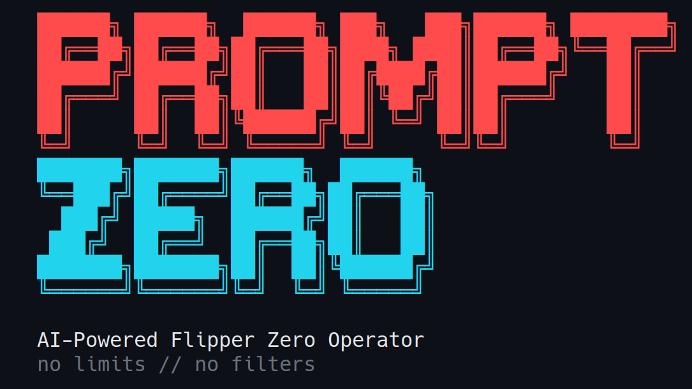

<!-- Translated copies: README.zh-CN.md, README.ja.md, README.de.md, README.fr.md, README.es.md, README.pt-BR.md. Update them in the same change. -->
<p align="center">
  
</p>

<p align="center"><a href="README.md">English</a>&emsp;<a href="README.zh-CN.md">简体中文</a>&emsp;<a href="README.ja.md">日本語</a>&emsp;<b>Deutsch</b>&emsp;<a href="README.fr.md">Français</a>&emsp;<a href="README.es.md">Español</a>&emsp;<a href="README.pt-BR.md">Português</a></p>

<h3 align="center">Sprich mit deinem Flipper Zero wie mit einem Menschen — er baut das Payload, spielt es ein und führt es aus</h3>

<p align="center">Ein Operator in natürlicher Sprache für den Flipper Zero und den ESP32 Marauder.<br>
Sub-GHz, NFC, RFID, IR, BadUSB und WiFi — gesteuert von Claude, abgesichert durch eine Risiko-Engine.</p>

<p align="center">
  <a href="https://github.com/xunholy/promptzero/releases/latest"></a>
  <a href="LICENSE"></a>
  <a href="https://github.com/xunholy/promptzero/actions/workflows/ci.yaml"></a>
  <a href="go.mod"></a>
  <a href="docs/reference/transports.md"></a>
  <a href="scripts/claude-usage.py"></a>
</p>

<p align="center">
  <a href="#schnellstart"><b>Schnellstart</b></a>&emsp;
  <a href="#was-es-kann"><b>Was&nbsp;es&nbsp;kann</b></a>&emsp;
  <a href="#modi"><b>Modi</b></a>&emsp;
  <a href="#sicherheitsmodell"><b>Sicherheit</b></a>&emsp;
  <a href="docs/"><b>Dokumentation</b></a>
</p>

> [!CAUTION]
> **Nur für autorisierten Einsatz.** PromptZero erzeugt und führt RF-, NFC-, RFID- und HID-Payloads aus — außerhalb von Umgebungen, die dir gehören oder für die du eine schriftliche Testfreigabe hast, illegal. Lies [`SECURITY.md`](SECURITY.md) für das Sicherheitsmodell und die Bedrohungsgrenze. Das Projekt befindet sich in aktiver Entwicklung; APIs und Werkzeuge ändern sich zwischen Minor-Versionen.
>
> *Durchgängig mit [Claude](https://claude.ai) gebaut. Prüfe erzeugte Payloads vor dem Einsatz.*

<p align="center">
  
</p>

Beschreibe in einem Satz, was du willst. PromptZero kommuniziert mit deinem Flipper Zero (und einem optionalen ESP32-Marauder-WiFi-Devboard) über USB-Seriell oder BLE, erzeugt das Payload, spielt es auf die SD-Karte ein und führt es aus — wobei jede riskante Aktion unterwegs ein Consent-Gate passiert und im Audit-Log landet.

```
promptzero> make me a Starbucks WiFi captive portal
  Generated and deployed evil_portal to /ext/apps_data/evil_portal/index.html
  Evil portal started on Marauder devboard

promptzero> scan for nearby WiFi networks and deauth the strongest one
  Found 12 access points. Strongest: "NETGEAR-5G" (-31 dBm, channel 6)
  Selected AP 0. Deauth attack running...

promptzero> create a BadUSB payload that opens a reverse shell on Windows
  Generated and deployed badusb to /ext/badusb/generated_payload.txt
  Ready to execute - plug into target and run

promptzero> identify this device: /tmp/remote.jpg
  That's a Samsung BN59 series TV remote using the Samsung32 IR protocol.
  I can generate a complete remote file. Want me to create it?
```

## Schnellstart

**Voraussetzungen** — ein Flipper Zero mit modifizierter Firmware (Momentum / Unleashed / RogueMaster), ein Anthropic-API-Key und ein USB-Kabel.

```bash
# 1. Install (Linux/macOS, amd64/arm64) — pinned to release artifacts (immutable per tag)
curl -fsSL https://github.com/xunholy/promptzero/releases/latest/download/install.sh | sh

# 2. Configure
export ANTHROPIC_API_KEY="sk-ant-..."

# 3. Run
promptzero
```

```
promptzero> what's connected?
  Flipper Zero — firmware 0.99.1, hardware v7.4
  Battery 84 % | SD card 4.1 GB free / 7.4 GB total
```

Das war das gesamte Onboarding. Ab hier gibst du Anweisungen in natürlicher Sprache ein oder `/help`, um die Slash-Befehle zu sehen.

> [!TIP]
> **Defensive Haltung (Sicherheitsleitplanke mit einem Flag):** füge `--read-only` hinzu, um jedes Werkzeug abzulehnen, das schreibt, sendet oder ausführt. Reine Lesevorgänge / Scans / Abfragen werden weiterhin ausgeführt; alles ab Risiko-Medium wird an der Grenze abgelehnt.
>
> ```bash
> promptzero --read-only          # blue-team / forensics / training
> ```

**Weitere Wege:** Windows-Nutzer holen sich die `.zip` von der [Releases-Seite](https://github.com/xunholy/promptzero/releases). WSL2 benötigt USB-Passthrough — siehe [Transports → WSL2](docs/reference/transports.md#wsl2-usb-passthrough). Für drahtloses BLE, Konfigurationsdateien, Personas, Umgebungsvariablen und Selbst-Upgrade: [Konfigurationsreferenz](docs/reference/configuration.md).

## Was es kann

PromptZero steuert alles über natürliche Sprache — ein Agent, eine lebende Werkzeug-Registry, die von Release zu Release wächst, und ein Risiko-Gate vor allem, was die Außenwelt berührt.

| Subsystem | Fähigkeiten |
|---|---|
| **Flipper Zero** | Sub-GHz TX/RX, IR TX/RX, NFC erkennen/emulieren, RFID lesen/schreiben/emulieren, iButton, GPIO, BadUSB, Speicher, App-Launcher |
| **ESP32 Marauder** | WiFi-Scan, Deauth, Beacon-Spam, Probe-Flood, PMKID-Erfassung, Evil Portal, BLE-Spam, BT-Scanning, Skimmer-Erkennung, Wardriving, MAC-Spoofing |
| **KI-Generierung** | Evil-Portal-HTML, BadUSB-DuckyScript, Sub-GHz `.sub`, IR `.ir`, NFC `.nfc` aus natürlicher Sprache — plus parametrische Builder für typisierte Parameter |
| **Aufklärung** | Bildanalyse per Claude Vision (Dateipfad → Geräte-ID + Angriffsvektor), SD-Karten-Erkundung |
| **Audit** | SQLite-Audit-Log mit MITRE ATT&CK-Technik-Tags, Sitzungsexport, Statistiken |

Führe `promptzero` aus und gib `/tools` ein für die Live-Registry.

<details>
<summary><b>Unter der Haube — die Agent-Schicht</b></summary>
<br>

Der Agent von PromptZero bringt Prompt-Caching mit, kostenstufenbasiertes Modell-Routing (Recon auf Haiku, Exploit auf Opus), Prompt-Injection-Quarantäne, Reflexion-on-Error mit strukturiertem `ToolError`, ein `<device-state>`-Orakel, das in jeder Runde eingespeist wird, und OpenTelemetry-GenAI-Spans. Das LLM ist eine Komponente, keine Bibliothek: Modell- und Anbieterwechsel sind erstklassig unterstützt, und kein Prompt ist tragend. Architekturdetails in [`docs/`](docs/).

</details>

## Modi

### CLI — `promptzero`

Der Standard. Eine interaktive REPL.

```
promptzero> scan the SD card and show me what signals I have saved
promptzero> transmit the garage door signal
promptzero> read the NFC tag on my desk
```

Slash-Befehle (führe `/help` aus für die vollständige Liste mit Beschreibungen):

- **Konversation** — `/help`, `/reset`, `/quit`
- **Sitzung** — `/sessions`, `/save <name>`, `/resume <id>`, `/forget <id>`
- **Info** — `/status`, `/tools [query|page <n>]`, `/history [N]`, `/audit {stats|find|tail|top|session|query|export}`, `/stats [section]`, `/cost`, `/budget [set <USD>|off]`, `/debug`
- **Operator** — `/persona [name]`, `/mode [name]`, `/watch [pause|resume]`, `/webhooks [test <name>]`, `/validate <path>`, `/attack {set|clear} <techniques>`, `/campaign {validate|run} <file>`, `/rewind [snapshot]`, `/report [session] [json] [save]`, `/rules [list|pause|resume|test]`
- **Gerät** — `/reconnect`

Tastenkürzel während einer Runde:

- **Ctrl+C** — die aktuelle Runde vollständig abbrechen.
- **Ctrl+G** — das aktuell streamende Werkzeug (z. B. `subghz_receive`, `wifi_scan_ap`) abbrechen, den Agenten aber mit dem Teilergebnis fortfahren lassen.
- **Ctrl+R** — rückwärts-inkrementelle Verlaufssuche.
- **Ctrl+L** — Bildschirm leeren.

### Web UI — `promptzero --web`

Eine dunkel gestaltete Browser-Oberfläche unter `http://localhost:8080`: die Chat-Fläche, ein Live-Flipper-Viewport, ein Dateibrowser, das Audit-Log, ein Report-Builder und — wenn ein Marauder angeschlossen ist — ein TFT-Display-Panel.

> [!IMPORTANT]
> **Auth.** Setze `web.token` in deiner Konfiguration oder `PROMPTZERO_WEB_TOKEN` in der Umgebung. Der Browser übernimmt beim ersten Laden `#token=…` aus dem URL-Fragment und speichert es im `sessionStorage`. Leerer Token + Nicht-Loopback-Bind → der Server gibt eine rote Warnung aus. PromptZero spricht reines HTTP — terminiere TLS an einem Reverse Proxy (Caddy / Traefik / nginx) oder einem Tailscale- / Cloudflare-Tunnel.

**Hoste es mit Docker.** Multi-Arch-Images (`distroless`, signiert, mit SBOM + Provenance) werden bei jedem Release nach `ghcr.io/xunholy/promptzero` veröffentlicht — siehe [docs/deploy/docker.md](docs/deploy/docker.md).

**Health-Probes.** `GET /healthz` (Liveness, `200 ok`) und `GET /readyz` (Readiness, JSON-Subsystem-Snapshot) sind für Headless- / systemd- / k8s-Deployment nicht authentifiziert; die Gerätekonnektivität wird gemeldet, blockiert die Readiness aber nicht (ein Flipper/Marauder kann sich nach dem Start verbinden).

### Voice — `promptzero --voice`

Push-to-Talk im CLI-Modus. Drücke Enter ohne Text, um aufzunehmen (erfordert `sox`); das Audio wird per OpenAI Whisper transkribiert und dann als normaler Befehl verarbeitet.

```
Ubuntu/Debian:  apt install sox
macOS (brew):   brew install sox
Arch:           pacman -S sox
```

### MCP — `promptzero --mcp`

Läuft als [Model Context Protocol](https://modelcontextprotocol.io/)-Server über stdio. Füge es zu Claude Desktop / Claude Code hinzu:

```json
{
  "mcpServers": {
    "promptzero": {
      "command": "/path/to/promptzero",
      "args": ["--mcp"]
    }
  }
}
```

> [!IMPORTANT]
> **MCP-Risiko-Gate.** Werkzeuge mit Risiko-High und Risiko-Critical werden standardmäßig abgelehnt — setze `PROMPTZERO_MCP_ALLOW_HIGH=1` und / oder `PROMPTZERO_MCP_ALLOW_CRITICAL=1`, um sie zuzulassen. Alle MCP-Aufrufe (zugelassen oder abgelehnt) werden im Audit-Log festgehalten. Siehe [Sicherheitsmodell](#sicherheitsmodell) weiter unten.

## Sicherheitsmodell

PromptZero ist Dual-Use-Offensivwerkzeug. Die Sicherheitsgeschichte ist die soziale Existenzberechtigung des Projekts — jede Spec trägt eine Risikostufe, und die Stufe entscheidet, was frei ausgeführt wird und was bestätigt werden muss.

 &nbsp;Scans, Lesevorgänge und Abfragen — frei ausgeführt.<br>
 &nbsp;Datenschreibvorgänge und Signalemulation.<br>
 &nbsp;aktives RF-Senden, Tag-Schreibvorgänge und Skriptausführung — **Operator-Bestätigung erforderlich.**<br>
 &nbsp;Brute-Force- und destruktive Angriffe — **Operator-Bestätigung erforderlich.**

- **Consent-Gate.** High- und Critical-Werkzeuge erfordern eine Operator-Bestätigung. Die CLI zeigt eine umrahmte Vorschau (Frequenz / Modulation / Hex) mit einer 2-Sekunden-Verzögerung; positive Zustimmung (`y`, `all`, `confirm`) wird abgelehnt, bevor die Verzögerung abgelaufen ist. Negative Entscheidungen (`n`, `r` für Überarbeiten, Esc) umgehen die Verzögerung.
- **MCP lehnt standardmäßig ab.** Kein MCP-Client kann High+-Werkzeuge ohne explizites Opt-in per Umgebungsvariable ausführen (siehe oben).
- **Audit-Log fail-closed.** Ist kein Audit-Log initialisiert, verweigert der Agent High+-Aktionen, statt sie stillschweigend auszuführen.
- **Prompt-Injection-Quarantäne.** Werkzeugausgaben (gescannte SSIDs, erfasste Pakete, Bildinhalte, SD-Dateinamen) werden gekapselt, bevor sie wieder in das Modell eingespeist werden, damit sie den System-Prompt nicht überschreiben können.
- **Kein Auto-Deploy erzeugter Payloads.** BadUSB-Skripte werden standardmäßig ohne Ausführung eingespielt.

Lies [`SECURITY.md`](SECURITY.md) für das vollständige Bedrohungsmodell, den Geltungsbereich / Nicht-Geltungsbereich und wie du eine Schwachstelle meldest.

## Kompatibilität

<details open>
<summary><b>Firmware-Unterstützung</b></summary>
<br>

| Firmware | Status |
|---|---|
| **Momentum** (ehemals Xtreme) | Primäres Ziel |
| **Unleashed** | Unterstützt |
| **RogueMaster** | Unterstützt |
| **Offiziell (OFW) 1.x** | Unterstützt mit reduziertem Funktionsumfang — regionsgesperrtes Sub-GHz, kein Rolling Code |

</details>

> [!NOTE]
> Die offizielle Firmware sperrt Sub-GHz-TX auf regionsspezifische ISM-Bänder und blockiert Rolling-Code-Protokolle. Modifizierte Firmware schaltet den vollen CC1101-Bereich frei (300–348 / 387–464 / 779–928 MHz) und aktiviert TX für alle 52 unterstützten Protokolle.

Das ESP32-Marauder-Devboard benötigt Firmware **v1.11.1+** über USB CDC ACM (`/dev/ttyACM1` für das offizielle Flipper-WiFi-Devboard, Baudrate 115200). Für drahtloses BLE (kein Kabel, alle Werkzeuge funktionieren, ~10× langsamer als USB) und das plattformspezifische Pairing siehe die [Transports-Referenz](docs/reference/transports.md).

## Dokumentation

- [`docs/`](docs/) — Handbuch mit aufgabenorientierten Szenarien, Prompt-Mustern und reproduzierbaren Transkripten.
- [`docs/reference/tools.md`](docs/reference/tools.md) — eine kuratierte Referenz der Schemas, Risikostufen der **Kern**-Werkzeuge und der Prompts, die sie zuverlässig auslösen. Führe `/tools` (oder `tool_search`) aus für die vollständige Live-Registry.
- [`docs/reference/transports.md`](docs/reference/transports.md) — Einrichtung von Seriell, BLE, WSL2.
- [`docs/reference/configuration.md`](docs/reference/configuration.md) — Konfigurationsdatei, Umgebungsvariablen, Personas, Regeln, Selbst-Upgrade.
- [`SECURITY.md`](SECURITY.md) — Bedrohungsmodell und Offenlegungsrichtlinie.
- [`examples/`](examples/) — Copy-Paste-Vorlagen: Konfiguration, Regeln, vier Operator-Personas (Red Team / Blue Team / CTF / Hardware-Lab).
- [`CHANGELOG.md`](CHANGELOG.md) — was in jedem Release enthalten ist.

## Bauen & beitragen

Siehe [`CONTRIBUTING.md`](CONTRIBUTING.md). Kurzfassung:

```bash
git clone https://github.com/xunholy/promptzero.git
cd promptzero
task dev:setup
task build
task test
```

## Lizenz

[AGPL-3.0-or-later](LICENSE). Wer ein modifiziertes PromptZero als Netzwerkdienst betreibt, muss die Quelltextänderungen unter derselben Lizenz veröffentlichen.

<br>

<sub align="center">Das Claude-Nutzungs-/Kosten-Badge ist eine Schätzung, aggregiert aus den lokalen Claude-Code-Transkripten des Maintainers (`task claude-usage`); es spiegelt nur die Sitzungen dieser Maschine wider.</sub>

<p align="center"><sub>Gebaut mit <a href="https://claude.ai">Claude</a> von <a href="https://github.com/xunholy">xunholy</a>.</sub></p>
