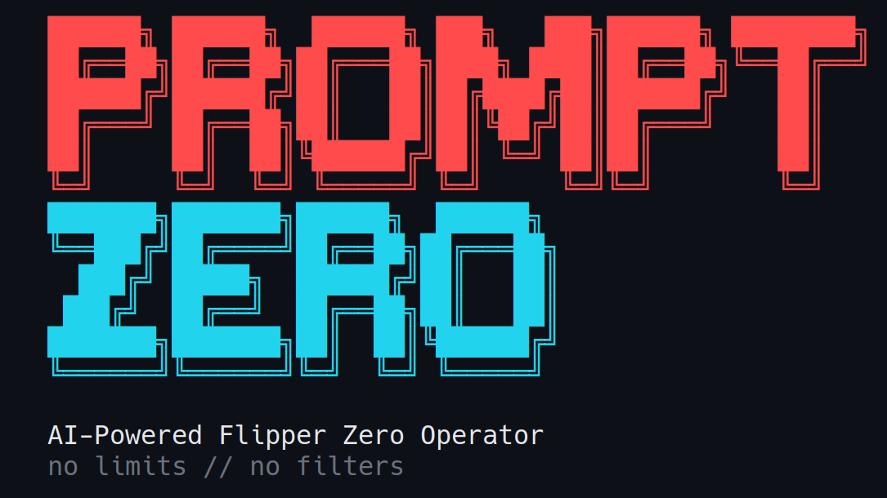

<!-- Translated copies: README.zh-CN.md, README.ja.md, README.de.md, README.fr.md, README.es.md, README.pt-BR.md. Update them in the same change. -->
<p align="center">
  
</p>

<p align="center"><a href="README.md">English</a>&emsp;<a href="README.zh-CN.md">简体中文</a>&emsp;<a href="README.ja.md">日本語</a>&emsp;<a href="README.de.md">Deutsch</a>&emsp;<a href="README.fr.md">Français</a>&emsp;<b>Español</b>&emsp;<a href="README.pt-BR.md">Português</a></p>

<h3 align="center">Habla con tu Flipper Zero como con una persona: construye el payload, lo despliega y lo ejecuta</h3>

<p align="center">Un operador en lenguaje natural para el Flipper Zero y el ESP32 Marauder.<br>
Sub-GHz, NFC, RFID, IR, BadUSB y WiFi, impulsado por Claude y controlado por un motor de riesgo.</p>

<p align="center">
  <a href="https://github.com/xunholy/promptzero/releases/latest"></a>
  <a href="LICENSE"></a>
  <a href="https://github.com/xunholy/promptzero/actions/workflows/ci.yaml"></a>
  <a href="go.mod"></a>
  <a href="docs/reference/transports.md"></a>
  <a href="scripts/claude-usage.py"></a>
</p>

<p align="center">
  <a href="#inicio-rápido"><b>Inicio&nbsp;rápido</b></a>&emsp;
  <a href="#qué-hace"><b>Qué&nbsp;hace</b></a>&emsp;
  <a href="#modos"><b>Modos</b></a>&emsp;
  <a href="#modelo-de-seguridad"><b>Seguridad</b></a>&emsp;
  <a href="docs/"><b>Docs</b></a>
</p>

> [!CAUTION]
> **Solo para uso autorizado.** PromptZero genera y ejecuta payloads de RF, NFC, RFID y HID, ilegales fuera de contextos que poseas o para cuya prueba tengas autorización por escrito. Lee [`SECURITY.md`](SECURITY.md) para conocer el modelo de seguridad y el límite de amenazas. El proyecto está en desarrollo activo; las API y las herramientas cambian entre versiones menores.
>
> *Construido de principio a fin con [Claude](https://claude.ai). Revisa los payloads generados antes de desplegarlos.*

<p align="center">
  
</p>

Describe lo que quieres en una frase. PromptZero se comunica con tu Flipper Zero (y una placa de desarrollo WiFi ESP32 Marauder opcional) por USB serie o BLE, genera el payload, lo despliega en la tarjeta SD y lo ejecuta: cada acción arriesgada pasa por una comprobación de consentimiento y queda registrada en un log de auditoría por el camino.

```
promptzero> make me a Starbucks WiFi captive portal
  Generated and deployed evil_portal to /ext/apps_data/evil_portal/index.html
  Evil portal started on Marauder devboard

promptzero> scan for nearby WiFi networks and deauth the strongest one
  Found 12 access points. Strongest: "NETGEAR-5G" (-31 dBm, channel 6)
  Selected AP 0. Deauth attack running...

promptzero> create a BadUSB payload that opens a reverse shell on Windows
  Generated and deployed badusb to /ext/badusb/generated_payload.txt
  Ready to execute - plug into target and run

promptzero> identify this device: /tmp/remote.jpg
  That's a Samsung BN59 series TV remote using the Samsung32 IR protocol.
  I can generate a complete remote file. Want me to create it?
```

## Inicio rápido

**Requisitos previos**: un Flipper Zero con firmware modificado (Momentum / Unleashed / RogueMaster), una clave de API de Anthropic y un cable USB.

```bash
# 1. Install (Linux/macOS, amd64/arm64) — pinned to release artifacts (immutable per tag)
curl -fsSL https://github.com/xunholy/promptzero/releases/latest/download/install.sh | sh

# 2. Configure
export ANTHROPIC_API_KEY="sk-ant-..."

# 3. Run
promptzero
```

```
promptzero> what's connected?
  Flipper Zero — firmware 0.99.1, hardware v7.4
  Battery 84 % | SD card 4.1 GB free / 7.4 GB total
```

Eso es toda la incorporación. A partir de aquí, escribe instrucciones en lenguaje natural o `/help` para ver los comandos de barra.

> [!TIP]
> **Postura defensiva (barrera de seguridad de un solo flag):** añade `--read-only` para rechazar cualquier herramienta que escriba, transmita o ejecute. Las lecturas / escaneos / consultas puras se siguen ejecutando; cualquier cosa de riesgo Medio o superior se rechaza en el límite.
>
> ```bash
> promptzero --read-only          # blue-team / forensics / training
> ```

**Otras vías:** los usuarios de Windows pueden descargar el `.zip` desde la [página de releases](https://github.com/xunholy/promptzero/releases). WSL2 necesita passthrough de USB; consulta [Transports → WSL2](docs/reference/transports.md#wsl2-usb-passthrough). Para BLE inalámbrico, archivos de configuración, personas, variables de entorno y autoactualización: [referencia de configuración](docs/reference/configuration.md).

## Qué hace

PromptZero lo controla todo mediante lenguaje natural: un solo agente, un registro de herramientas vivo que crece versión tras versión y una compuerta de riesgo delante de cualquier cosa que toque el mundo real.

| Subsistema | Capacidades |
|---|---|
| **Flipper Zero** | Sub-GHz TX/RX, IR TX/RX, detección/emulación NFC, lectura/escritura/emulación RFID, iButton, GPIO, BadUSB, almacenamiento, lanzador de apps |
| **ESP32 Marauder** | escaneo WiFi, deauth, beacon spam, probe flood, captura de PMKID, evil portal, BLE spam, escaneo BT, detección de skimmers, wardriving, suplantación de MAC |
| **Generación con IA** | HTML de evil portal, DuckyScript para BadUSB, `.sub` de Sub-GHz, `.ir` de IR, `.nfc` de NFC a partir de lenguaje natural, además de constructores paramétricos para parámetros tipados |
| **Inteligencia** | Análisis de imágenes mediante la visión de Claude (ruta de archivo → identificación del dispositivo + vector de ataque), descubrimiento de la tarjeta SD |
| **Auditoría** | Log de auditoría en SQLite con etiquetas de técnicas MITRE ATT&CK, exportación de sesiones, estadísticas |

Ejecuta `promptzero` y escribe `/tools` para ver el registro en vivo.

<details>
<summary><b>Bajo el capó: la capa del agente</b></summary>
<br>

El agente de PromptZero incorpora caché de prompts, enrutamiento de modelos por nivel de coste (reconocimiento en Haiku, explotación en Opus), cuarentena contra inyección de prompts, reflexión ante errores con `ToolError` estructurado, un oráculo `<device-state>` inyectado en cada turno y spans de GenAI de OpenTelemetry. El LLM es un componente, no una biblioteca: cambiar de modelo o de proveedor es de primera clase y ningún prompt es estructural. Consulta [`docs/`](docs/) para los detalles de arquitectura.

</details>

## Modos

### CLI — `promptzero`

El modo por defecto. Un REPL interactivo.

```
promptzero> scan the SD card and show me what signals I have saved
promptzero> transmit the garage door signal
promptzero> read the NFC tag on my desk
```

Comandos de barra (ejecuta `/help` para ver la lista completa con descripciones):

- **Conversación** — `/help`, `/reset`, `/quit`
- **Sesión** — `/sessions`, `/save <name>`, `/resume <id>`, `/forget <id>`
- **Información** — `/status`, `/tools [query|page <n>]`, `/history [N]`, `/audit {stats|find|tail|top|session|query|export}`, `/stats [section]`, `/cost`, `/budget [set <USD>|off]`, `/debug`
- **Operador** — `/persona [name]`, `/mode [name]`, `/watch [pause|resume]`, `/webhooks [test <name>]`, `/validate <path>`, `/attack {set|clear} <techniques>`, `/campaign {validate|run} <file>`, `/rewind [snapshot]`, `/report [session] [json] [save]`, `/rules [list|pause|resume|test]`
- **Dispositivo** — `/reconnect`

Combinaciones de teclas durante un turno:

- **Ctrl+C** — cancela por completo el turno actual.
- **Ctrl+G** — aborta la herramienta de streaming actual (p. ej. `subghz_receive`, `wifi_scan_ap`) pero deja que el agente continúe con el resultado parcial.
- **Ctrl+R** — búsqueda incremental inversa en el historial.
- **Ctrl+L** — limpia la pantalla.

### Interfaz web — `promptzero --web`

Una interfaz de navegador con tema oscuro en `http://localhost:8080`: la superficie de chat, un visor en vivo del Flipper, un explorador de archivos, el log de auditoría, un generador de informes y —cuando hay un Marauder conectado— un panel de pantalla TFT.

> [!IMPORTANT]
> **Autenticación.** Establece `web.token` en tu configuración o `PROMPTZERO_WEB_TOKEN` en el entorno. El navegador toma `#token=…` del fragmento de la URL en la primera carga y lo guarda en `sessionStorage`. Token vacío + bind que no sea de loopback → el servidor imprime una advertencia en rojo. PromptZero habla HTTP plano: termina el TLS en un proxy inverso (Caddy / Traefik / nginx) o en un túnel de Tailscale / Cloudflare.

**Hospédalo con Docker.** En cada release se publican imágenes multiarquitectura (`distroless`, firmadas, con SBOM + procedencia) en `ghcr.io/xunholy/promptzero`; consulta [docs/deploy/docker.md](docs/deploy/docker.md).

**Sondas de salud.** `GET /healthz` (liveness, `200 ok`) y `GET /readyz` (readiness, instantánea JSON de los subsistemas) no requieren autenticación para despliegues headless / systemd / k8s; la conectividad del dispositivo se informa pero no condiciona el readiness (un Flipper/Marauder puede conectarse después del arranque).

### Voz — `promptzero --voice`

Pulsar para hablar en modo CLI. Pulsa Enter sin texto para grabar (requiere `sox`); el audio se transcribe mediante OpenAI Whisper y luego se procesa como un comando normal.

```
Ubuntu/Debian:  apt install sox
macOS (brew):   brew install sox
Arch:           pacman -S sox
```

### MCP — `promptzero --mcp`

Se ejecuta como un servidor [Model Context Protocol](https://modelcontextprotocol.io/) sobre stdio. Añádelo a Claude Desktop / Claude Code:

```json
{
  "mcpServers": {
    "promptzero": {
      "command": "/path/to/promptzero",
      "args": ["--mcp"]
    }
  }
}
```

> [!IMPORTANT]
> **Compuerta de riesgo de MCP.** Las herramientas de riesgo Alto y Crítico se rechazan por defecto; establece `PROMPTZERO_MCP_ALLOW_HIGH=1` y/o `PROMPTZERO_MCP_ALLOW_CRITICAL=1` para permitirlas. Todas las llamadas MCP (permitidas o denegadas) quedan registradas en el log de auditoría. Consulta [Modelo de seguridad](#modelo-de-seguridad) más abajo.

## Modelo de seguridad

PromptZero es una herramienta ofensiva de doble uso. El relato de seguridad es la licencia social del proyecto para existir: cada spec lleva un nivel de riesgo, y ese nivel decide qué se ejecuta libremente y qué debe confirmarse.

 &nbsp;escaneos, lecturas y consultas: se ejecutan libremente.<br>
 &nbsp;escrituras de datos y emulación de señales.<br>
 &nbsp;transmisión activa de RF, escrituras en tags y ejecución de scripts: **se requiere confirmación del operador.**<br>
 &nbsp;ataques de fuerza bruta y destructivos: **se requiere confirmación del operador.**

- **Compuerta de consentimiento.** Las herramientas Altas y Críticas requieren confirmación del operador. La CLI muestra una vista previa en un recuadro (frecuencia / modulación / hex) con un retardo de 2 segundos; el consentimiento positivo (`y`, `all`, `confirm`) se rechaza antes de que se abra el retardo. Las decisiones negativas (`n`, `r` para revisar, Esc) se saltan el retardo.
- **MCP rechaza por defecto.** Ningún cliente MCP puede ejecutar herramientas High+ sin una habilitación explícita por variable de entorno (véase más arriba).
- **Log de auditoría fail-closed.** Si no hay un log de auditoría inicializado, el agente rechaza las acciones High+ en lugar de ejecutarlas en silencio.
- **Cuarentena contra inyección de prompts.** Las salidas de las herramientas (SSID escaneados, paquetes capturados, contenido de imágenes, nombres de archivo de la SD) se envuelven antes de devolverse al modelo para que no puedan anular el prompt del sistema.
- **Sin despliegue automático de los payloads generados.** Los scripts de BadUSB se despliegan sin ejecutarse por defecto.

Lee [`SECURITY.md`](SECURITY.md) para el modelo de amenazas completo, el alcance / fuera de alcance y cómo informar de una vulnerabilidad.

## Compatibilidad

<details open>
<summary><b>Compatibilidad de firmware</b></summary>
<br>

| Firmware | Estado |
|---|---|
| **Momentum** (antes Xtreme) | Objetivo principal |
| **Unleashed** | Compatible |
| **RogueMaster** | Compatible |
| **Oficial (OFW) 1.x** | Compatible con un conjunto de funciones reducido: Sub-GHz bloqueado por región, sin rolling code |

</details>

> [!NOTE]
> El firmware oficial restringe la TX de Sub-GHz a las bandas ISM específicas de cada región y bloquea los protocolos de rolling code. El firmware modificado desbloquea todo el rango del CC1101 (300–348 / 387–464 / 779–928 MHz) y habilita la TX para los 52 protocolos compatibles.

La placa de desarrollo ESP32 Marauder requiere el firmware **v1.11.1+** sobre USB CDC ACM (`/dev/ttyACM1` para la placa WiFi oficial del Flipper, baudios 115200). Para BLE inalámbrico (sin cable, todas las herramientas funcionan, ~10× más lento que USB) y el emparejamiento por plataforma, consulta la [referencia de Transports](docs/reference/transports.md).

## Documentación

- [`docs/`](docs/) — manual con escenarios orientados a tareas, patrones de prompts y transcripciones reproducibles.
- [`docs/reference/tools.md`](docs/reference/tools.md) — una referencia cuidada de los esquemas de las herramientas **principales**, sus niveles de riesgo y los prompts que las activan de forma fiable. Ejecuta `/tools` (o `tool_search`) para el registro en vivo completo.
- [`docs/reference/transports.md`](docs/reference/transports.md) — configuración de serie, BLE y WSL2.
- [`docs/reference/configuration.md`](docs/reference/configuration.md) — archivo de configuración, variables de entorno, personas, reglas y autoactualización.
- [`SECURITY.md`](SECURITY.md) — modelo de amenazas y política de divulgación.
- [`examples/`](examples/) — plantillas para copiar y pegar: configuración, reglas y cuatro personas de operador (red team / blue team / CTF / laboratorio de hardware).
- [`CHANGELOG.md`](CHANGELOG.md) — qué incluye cada release.

## Compilar y contribuir

Consulta [`CONTRIBUTING.md`](CONTRIBUTING.md). Versión breve:

```bash
git clone https://github.com/xunholy/promptzero.git
cd promptzero
task dev:setup
task build
task test
```

## Licencia

[AGPL-3.0-or-later](LICENSE). Hospedar una versión modificada de PromptZero como servicio de red obliga a publicar los cambios del código fuente bajo la misma licencia.

<br>

<sub align="center">El badge de uso/coste de Claude es una estimación agregada a partir de las transcripciones locales de Claude Code del maintainer (`task claude-usage`); refleja únicamente las sesiones de esa máquina.</sub>

<p align="center"><sub>Construido con <a href="https://claude.ai">Claude</a> por <a href="https://github.com/xunholy">xunholy</a>.</sub></p>
