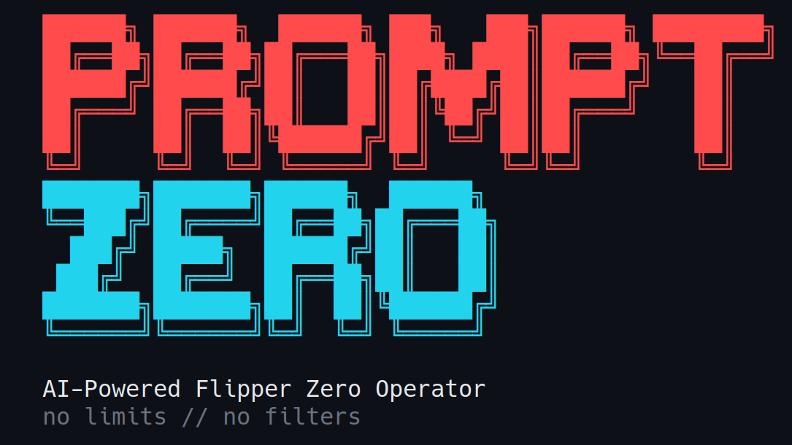

<!-- Translated copies: README.zh-CN.md, README.ja.md, README.de.md, README.fr.md, README.es.md, README.pt-BR.md. Update them in the same change. -->
<p align="center">
  
</p>

<p align="center"><a href="README.md">English</a>&emsp;<a href="README.zh-CN.md">简体中文</a>&emsp;<a href="README.ja.md">日本語</a>&emsp;<a href="README.de.md">Deutsch</a>&emsp;<b>Français</b>&emsp;<a href="README.es.md">Español</a>&emsp;<a href="README.pt-BR.md">Português</a></p>

<h3 align="center">Parlez à votre Flipper Zero comme à une personne — il crée la charge utile, la déploie et l'exécute</h3>

<p align="center">Un opérateur en langage naturel pour le Flipper Zero et l'ESP32 Marauder.<br>
Sub-GHz, NFC, RFID, IR, BadUSB et WiFi — piloté par Claude, encadré par un moteur de risque.</p>

<p align="center">
  <a href="https://github.com/xunholy/promptzero/releases/latest"></a>
  <a href="LICENSE"></a>
  <a href="https://github.com/xunholy/promptzero/actions/workflows/ci.yaml"></a>
  <a href="go.mod"></a>
  <a href="docs/reference/transports.md"></a>
  <a href="scripts/claude-usage.py"></a>
</p>

<p align="center">
  <a href="#démarrage-rapide"><b>Démarrage&nbsp;rapide</b></a>&emsp;
  <a href="#ce-quil-fait"><b>Ce&nbsp;qu'il&nbsp;fait</b></a>&emsp;
  <a href="#modes"><b>Modes</b></a>&emsp;
  <a href="#modèle-de-sécurité"><b>Sécurité</b></a>&emsp;
  <a href="docs/"><b>Docs</b></a>
</p>

> [!CAUTION]
> **Utilisation autorisée uniquement.** PromptZero génère et exécute des charges utiles RF, NFC, RFID et HID — illégales en dehors des contextes que vous possédez ou que vous avez l'autorisation écrite de tester. Lisez [`SECURITY.md`](SECURITY.md) pour le modèle de sécurité et la limite de la menace. Le projet est en développement actif ; les API et les outils changent d'une version mineure à l'autre.
>
> *Conçu de bout en bout avec [Claude](https://claude.ai). Vérifiez les charges utiles générées avant tout déploiement.*

<p align="center">
  
</p>

Décrivez ce que vous voulez en une phrase. PromptZero communique avec votre Flipper Zero (et une carte de développement WiFi ESP32 Marauder optionnelle) via USB série ou BLE, génère la charge utile, la déploie sur la carte SD et l'exécute — chaque action risquée passant par une porte de consentement et atterrissant dans un journal d'audit au passage.

```
promptzero> make me a Starbucks WiFi captive portal
  Generated and deployed evil_portal to /ext/apps_data/evil_portal/index.html
  Evil portal started on Marauder devboard

promptzero> scan for nearby WiFi networks and deauth the strongest one
  Found 12 access points. Strongest: "NETGEAR-5G" (-31 dBm, channel 6)
  Selected AP 0. Deauth attack running...

promptzero> create a BadUSB payload that opens a reverse shell on Windows
  Generated and deployed badusb to /ext/badusb/generated_payload.txt
  Ready to execute - plug into target and run

promptzero> identify this device: /tmp/remote.jpg
  That's a Samsung BN59 series TV remote using the Samsung32 IR protocol.
  I can generate a complete remote file. Want me to create it?
```

## Démarrage rapide

**Prérequis** — un Flipper Zero sous firmware modifié (Momentum / Unleashed / RogueMaster), une clé API Anthropic et un câble USB.

```bash
# 1. Install (Linux/macOS, amd64/arm64) — pinned to release artifacts (immutable per tag)
curl -fsSL https://github.com/xunholy/promptzero/releases/latest/download/install.sh | sh

# 2. Configure
export ANTHROPIC_API_KEY="sk-ant-..."

# 3. Run
promptzero
```

```
promptzero> what's connected?
  Flipper Zero — firmware 0.99.1, hardware v7.4
  Battery 84 % | SD card 4.1 GB free / 7.4 GB total
```

Voilà pour toute la prise en main. À partir de là, saisissez des instructions en langage naturel ou `/help` pour voir les commandes slash.

> [!TIP]
> **Posture défensive (un drapeau pour tout verrouiller) :** ajoutez `--read-only` pour refuser tout outil qui écrit, transmet ou exécute. Les lectures / scans / requêtes pures continuent d'être dispatchés ; tout ce qui est de risque Medium ou au-dessus est refusé à la frontière.
>
> ```bash
> promptzero --read-only          # blue-team / forensics / training
> ```

**Autres chemins :** les utilisateurs Windows récupèrent le `.zip` depuis la [page des releases](https://github.com/xunholy/promptzero/releases). WSL2 nécessite le passthrough USB — voir [Transports → WSL2](docs/reference/transports.md#wsl2-usb-passthrough). Pour le BLE sans fil, les fichiers de configuration, les personas, les variables d'environnement et la mise à niveau automatique : [Référence de configuration](docs/reference/configuration.md).

## Ce qu'il fait

PromptZero pilote tout via le langage naturel — un seul agent, un registre d'outils vivant qui s'enrichit à chaque version, et une porte de risque devant tout ce qui touche au monde réel.

| Sous-système | Capacités |
|---|---|
| **Flipper Zero** | TX/RX Sub-GHz, TX/RX IR, détection/émulation NFC, lecture/écriture/émulation RFID, iButton, GPIO, BadUSB, stockage, lanceur d'applications |
| **ESP32 Marauder** | scan WiFi, deauth, beacon spam, probe flood, capture PMKID, evil portal, BLE spam, scan BT, détection de skimmer, wardriving, usurpation d'adresse MAC |
| **Génération par IA** | HTML d'evil portal, DuckyScript BadUSB, `.sub` Sub-GHz, `.ir` IR, `.nfc` NFC à partir du langage naturel — plus des générateurs paramétriques pour les paramètres typés |
| **Renseignement** | analyse d'image via Claude vision (chemin de fichier → identification de l'appareil + vecteur d'attaque), découverte de la carte SD |
| **Audit** | journal d'audit SQLite avec tags de techniques MITRE ATT&CK, export de session, statistiques |

Lancez `promptzero` et saisissez `/tools` pour le registre en direct.

<details>
<summary><b>Sous le capot — la couche agent</b></summary>
<br>

L'agent de PromptZero embarque la mise en cache des prompts, un routage de modèles par palier de coût (reconnaissance sur Haiku, exploitation sur Opus), la mise en quarantaine contre l'injection de prompt, la réflexion sur erreur avec un `ToolError` structuré, un oracle `<device-state>` injecté à chaque tour et des spans GenAI OpenTelemetry. Le LLM est un composant, pas une bibliothèque : le remplacement du modèle et du fournisseur est traité en priorité, et aucun prompt n'est critique. Voir [`docs/`](docs/) pour les détails d'architecture.

</details>

## Modes

### CLI — `promptzero`

Le mode par défaut. Un REPL interactif.

```
promptzero> scan the SD card and show me what signals I have saved
promptzero> transmit the garage door signal
promptzero> read the NFC tag on my desk
```

Commandes slash (lancez `/help` pour la liste complète avec descriptions) :

- **Conversation** — `/help`, `/reset`, `/quit`
- **Session** — `/sessions`, `/save <name>`, `/resume <id>`, `/forget <id>`
- **Info** — `/status`, `/tools [query|page <n>]`, `/history [N]`, `/audit {stats|find|tail|top|session|query|export}`, `/stats [section]`, `/cost`, `/budget [set <USD>|off]`, `/debug`
- **Opérateur** — `/persona [name]`, `/mode [name]`, `/watch [pause|resume]`, `/webhooks [test <name>]`, `/validate <path>`, `/attack {set|clear} <techniques>`, `/campaign {validate|run} <file>`, `/rewind [snapshot]`, `/report [session] [json] [save]`, `/rules [list|pause|resume|test]`
- **Appareil** — `/reconnect`

Frappes clavier pendant un tour :

- **Ctrl+C** — annule entièrement le tour en cours.
- **Ctrl+G** — interrompt l'outil de streaming en cours (p. ex. `subghz_receive`, `wifi_scan_ap`) mais laisse l'agent continuer avec le résultat partiel.
- **Ctrl+R** — recherche incrémentale inversée dans l'historique.
- **Ctrl+L** — efface l'écran.

### Interface web — `promptzero --web`

Une interface navigateur à thème sombre sur `http://localhost:8080` : la surface de chat, une visualisation en direct du Flipper, un navigateur de fichiers, le journal d'audit, un générateur de rapports et — lorsqu'un Marauder est connecté — un panneau d'affichage TFT.

> [!IMPORTANT]
> **Authentification.** Définissez `web.token` dans votre configuration ou `PROMPTZERO_WEB_TOKEN` dans l'environnement. Le navigateur récupère `#token=…` depuis le fragment d'URL au premier chargement et le met en cache dans `sessionStorage`. Token vide + liaison non-loopback → le serveur affiche un avertissement en rouge. PromptZero parle du HTTP simple — terminez le TLS au niveau d'un reverse proxy (Caddy / Traefik / nginx) ou d'un tunnel Tailscale / Cloudflare.

**Hébergez-le avec Docker.** Des images multi-architectures (`distroless`, signées, avec SBOM + provenance) sont publiées sur `ghcr.io/xunholy/promptzero` à chaque release — voir [docs/deploy/docker.md](docs/deploy/docker.md).

**Sondes de santé.** `GET /healthz` (liveness, `200 ok`) et `GET /readyz` (readiness, instantané JSON des sous-systèmes) ne sont pas authentifiées pour un déploiement headless / systemd / k8s ; la connectivité des appareils est rapportée mais ne conditionne pas la disponibilité (un Flipper/Marauder peut se connecter après le démarrage).

### Voix — `promptzero --voice`

Push-to-talk en mode CLI. Appuyez sur Entrée sans texte pour enregistrer (nécessite `sox`) ; l'audio est transcrit via OpenAI Whisper, puis traité comme une commande normale.

```
Ubuntu/Debian:  apt install sox
macOS (brew):   brew install sox
Arch:           pacman -S sox
```

### MCP — `promptzero --mcp`

S'exécute comme un serveur [Model Context Protocol](https://modelcontextprotocol.io/) via stdio. À ajouter à Claude Desktop / Claude Code :

```json
{
  "mcpServers": {
    "promptzero": {
      "command": "/path/to/promptzero",
      "args": ["--mcp"]
    }
  }
}
```

> [!IMPORTANT]
> **Porte de risque MCP.** Les outils de risque High et Critical sont refusés par défaut — définissez `PROMPTZERO_MCP_ALLOW_HIGH=1` et / ou `PROMPTZERO_MCP_ALLOW_CRITICAL=1` pour les autoriser. Tous les appels MCP (autorisés ou refusés) sont enregistrés dans le journal d'audit. Voir [Modèle de sécurité](#modèle-de-sécurité) ci-dessous.

## Modèle de sécurité

PromptZero est un outillage offensif à double usage. Le volet sécurité est la licence sociale d'exister du projet — chaque spec porte un palier de risque, et ce palier décide de ce qui est dispatché librement et de ce qui doit être confirmé.

 &nbsp;scans, lectures et requêtes — dispatchés librement.<br>
 &nbsp;écritures de données et émulation de signal.<br>
 &nbsp;transmission RF active, écritures de tag et exécution de script — **confirmation de l'opérateur requise.**<br>
 &nbsp;attaques par force brute et destructrices — **confirmation de l'opérateur requise.**

- **Porte de consentement.** Les outils High et Critical nécessitent la confirmation de l'opérateur. La CLI affiche un aperçu encadré (fréquence / modulation / hex) avec un délai de 2 secondes ; un consentement positif (`y`, `all`, `confirm`) est rejeté avant l'ouverture du délai. Les décisions négatives (`n`, `r` pour réviser, Échap) contournent le délai.
- **MCP refuse par défaut.** Aucun client MCP ne peut exécuter d'outils High+ sans activation explicite par variable d'environnement (voir ci-dessus).
- **Journal d'audit en fail-closed.** Si aucun journal d'audit n'est initialisé, l'agent refuse les actions High+ plutôt que de les exécuter silencieusement.
- **Quarantaine contre l'injection de prompt.** Les sorties des outils (SSID scannés, paquets capturés, contenu d'image, noms de fichiers SD) sont encapsulées avant d'être réinjectées dans le modèle afin qu'elles ne puissent pas outrepasser le prompt système.
- **Pas de déploiement automatique des charges utiles générées.** Les scripts BadUSB sont déployés sans exécution par défaut.

Lisez [`SECURITY.md`](SECURITY.md) pour le modèle de menace complet, le périmètre / hors-périmètre, et la manière de signaler une vulnérabilité.

## Compatibilité

<details open>
<summary><b>Prise en charge des firmwares</b></summary>
<br>

| Firmware | Statut |
|---|---|
| **Momentum** (anciennement Xtreme) | Cible principale |
| **Unleashed** | Pris en charge |
| **RogueMaster** | Pris en charge |
| **Officiel (OFW) 1.x** | Pris en charge avec un jeu de fonctionnalités réduit — Sub-GHz verrouillé par région, pas de code tournant |

</details>

> [!NOTE]
> Le firmware officiel verrouille la TX Sub-GHz sur les bandes ISM spécifiques à la région et bloque les protocoles à code tournant. Le firmware modifié déverrouille toute la plage du CC1101 (300–348 / 387–464 / 779–928 MHz) et active la TX pour les 52 protocoles pris en charge.

La carte de développement ESP32 Marauder nécessite le firmware **v1.11.1+** via USB CDC ACM (`/dev/ttyACM1` pour la carte de développement WiFi officielle du Flipper, baud 115200). Pour le sans-fil BLE (pas de câble, tous les outils fonctionnent, ~10× plus lent que l'USB) et l'appairage selon la plateforme, voir la [référence Transports](docs/reference/transports.md).

## Documentation

- [`docs/`](docs/) — manuel avec des scénarios orientés tâches, des modèles de prompt et des transcriptions reproductibles.
- [`docs/reference/tools.md`](docs/reference/tools.md) — une référence organisée des schémas des outils **principaux**, de leurs niveaux de risque et des prompts qui les déclenchent de manière fiable. Lancez `/tools` (ou `tool_search`) pour le registre en direct complet.
- [`docs/reference/transports.md`](docs/reference/transports.md) — configuration série, BLE, WSL2.
- [`docs/reference/configuration.md`](docs/reference/configuration.md) — fichier de configuration, variables d'environnement, personas, règles, mise à niveau automatique.
- [`SECURITY.md`](SECURITY.md) — modèle de menace et politique de divulgation.
- [`examples/`](examples/) — modèles prêts à copier-coller : configuration, règles, quatre personas d'opérateur (red team / blue team / CTF / laboratoire matériel).
- [`CHANGELOG.md`](CHANGELOG.md) — le contenu de chaque release.

## Compilation et contribution

Voir [`CONTRIBUTING.md`](CONTRIBUTING.md). Version courte :

```bash
git clone https://github.com/xunholy/promptzero.git
cd promptzero
task dev:setup
task build
task test
```

## Licence

[AGPL-3.0-or-later](LICENSE). Héberger un PromptZero modifié en tant que service réseau impose de publier les modifications du code source sous la même licence.

<br>

<sub align="center">Le badge d'utilisation/coût Claude est une estimation agrégée à partir des transcriptions Claude Code locales du mainteneur (`task claude-usage`) ; il ne reflète que les sessions de cette machine.</sub>

<p align="center"><sub>Conçu avec <a href="https://claude.ai">Claude</a> par <a href="https://github.com/xunholy">xunholy</a>.</sub></p>
