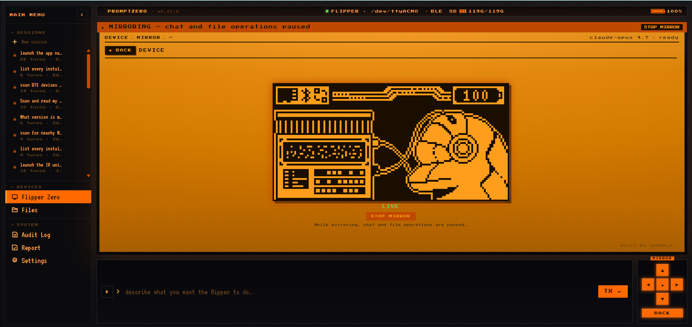

<!-- Translated copies: README.zh-CN.md, README.ja.md, README.de.md, README.fr.md, README.es.md, README.pt-BR.md. Update them in the same change. -->
<p align="center">
  <picture>
    <source media="(prefers-color-scheme: dark)" srcset=".github/assets/logo-dark.svg">
    
  </picture>
</p>

<p align="center"><a href="README.md">English</a>&emsp;<a href="README.zh-CN.md">简体中文</a>&emsp;<b>日本語</b>&emsp;<a href="README.de.md">Deutsch</a>&emsp;<a href="README.fr.md">Français</a>&emsp;<a href="README.es.md">Español</a>&emsp;<a href="README.pt-BR.md">Português</a></p>

<h3 align="center">Flipper Zero と人に話すように会話する — ペイロードを組み立て、デプロイし、実行する</h3>

<p align="center">Flipper Zero と ESP32 Marauder のための自然言語オペレーター。<br>
Sub-GHz、NFC、RFID、IR、BadUSB、WiFi を Claude が操り、リスクエンジンでゲートする。</p>

<p align="center">
  <a href="https://github.com/xunholy/promptzero/releases/latest"></a>
  <a href="LICENSE"></a>
  <a href="https://github.com/xunholy/promptzero/actions/workflows/ci.yaml"></a>
  <a href="go.mod"></a>
  <a href="docs/reference/transports.md"></a>
  <a href="scripts/claude-usage.py"></a>
</p>

<p align="center">
  <a href="#クイックスタート"><b>クイック&nbsp;スタート</b></a>&emsp;
  <a href="#できること"><b>できること</b></a>&emsp;
  <a href="#モード"><b>モード</b></a>&emsp;
  <a href="#セーフティモデル"><b>セーフティ</b></a>&emsp;
  <a href="docs/"><b>ドキュメント</b></a>
</p>

> [!CAUTION]
> **許可された用途のみ。** PromptZero は RF、NFC、RFID、HID のペイロードを生成して実行します。自分が所有する、あるいはテストの書面による許可を得たコンテキスト以外では違法です。セーフティモデルと脅威の境界については [`SECURITY.md`](SECURITY.md) をお読みください。本プロジェクトは活発に開発中であり、API とツールはマイナーバージョン間で変わります。
>
> *[Claude](https://claude.ai) でエンドツーエンドに構築。デプロイ前に生成されたペイロードをレビューしてください。*

<p align="center">
  
</p>

やりたいことを一文で説明してください。PromptZero は USB シリアルまたは BLE 経由であなたの Flipper Zero（およびオプションの ESP32 Marauder WiFi デブボード）と通信し、ペイロードを生成し、SD カードにデプロイし、実行します。その過程で、リスクを伴うすべてのアクションは同意ゲートを通過し、監査ログに記録されます。

```
promptzero> make me a Starbucks WiFi captive portal
  Generated and deployed evil_portal to /ext/apps_data/evil_portal/index.html
  Evil portal started on Marauder devboard

promptzero> scan for nearby WiFi networks and deauth the strongest one
  Found 12 access points. Strongest: "NETGEAR-5G" (-31 dBm, channel 6)
  Selected AP 0. Deauth attack running...

promptzero> create a BadUSB payload that opens a reverse shell on Windows
  Generated and deployed badusb to /ext/badusb/generated_payload.txt
  Ready to execute - plug into target and run

promptzero> identify this device: /tmp/remote.jpg
  That's a Samsung BN59 series TV remote using the Samsung32 IR protocol.
  I can generate a complete remote file. Want me to create it?
```

## クイックスタート

**前提条件** — モッド済みファームウェア（Momentum / Unleashed / RogueMaster）を載せた Flipper Zero、Anthropic API キー、そして USB ケーブル。

```bash
# 1. Install (Linux/macOS, amd64/arm64) — pinned to release artifacts (immutable per tag)
curl -fsSL https://github.com/xunholy/promptzero/releases/latest/download/install.sh | sh

# 2. Configure
export ANTHROPIC_API_KEY="sk-ant-..."

# 3. Run
promptzero
```

```
promptzero> what's connected?
  Flipper Zero — firmware 0.99.1, hardware v7.4
  Battery 84 % | SD card 4.1 GB free / 7.4 GB total
```

オンボーディングはこれだけです。ここから自然言語の指示を入力するか、`/help` でスラッシュコマンドを確認してください。

> [!TIP]
> **防御的な構え（フラグ 1 つのセーフティレール）：** `--read-only` を付けると、書き込み・送信・実行を行うあらゆるツールを拒否します。純粋な読み取り／スキャン／クエリはそのまま実行され、リスク Medium 以上はすべて境界で拒否されます。
>
> ```bash
> promptzero --read-only          # blue-team / forensics / training
> ```

**その他の経路：** Windows ユーザーは [リリースページ](https://github.com/xunholy/promptzero/releases) から `.zip` を入手してください。WSL2 では USB パススルーが必要です — [Transports → WSL2](docs/reference/transports.md#wsl2-usb-passthrough) を参照。ワイヤレス BLE、設定ファイル、ペルソナ、環境変数、セルフアップグレードについては [設定リファレンス](docs/reference/configuration.md) を参照してください。

## できること

PromptZero はすべてを自然言語で制御します — 単一のエージェント、リリースごとに拡充されるライブツールレジストリ、そして現実世界に触れるあらゆるものの前に立つリスクゲート。

| サブシステム | 機能 |
|---|---|
| **Flipper Zero** | Sub-GHz TX/RX、IR TX/RX、NFC 検出/エミュレート、RFID 読み取り/書き込み/エミュレート、iButton、GPIO、BadUSB、ストレージ、アプリランチャー |
| **ESP32 Marauder** | WiFi スキャン、deauth、ビーコンスパム、プローブフラッド、PMKID キャプチャ、evil portal、BLE スパム、BT スキャン、スキマー検出、ウォードライビング、MAC スプーフィング |
| **AI 生成** | 自然言語からの Evil portal HTML、BadUSB DuckyScript、Sub-GHz `.sub`、IR `.ir`、NFC `.nfc` — さらに型付きパラメーター向けのパラメトリックビルダー |
| **インテリジェンス** | Claude vision による画像解析（ファイルパス → デバイス ID + 攻撃ベクトル）、SD カード探索 |
| **監査** | MITRE ATT&CK テクニックタグ付きの SQLite 監査ログ、セッションエクスポート、統計 |

`promptzero` を実行し `/tools` と入力すると、ライブレジストリが表示されます。

<details>
<summary><b>内部の仕組み — エージェントレイヤー</b></summary>
<br>

PromptZero のエージェントは、プロンプトキャッシング、コストティアに応じたモデルルーティング（recon は Haiku、exploit は Opus）、プロンプトインジェクションの隔離、構造化された `ToolError` によるエラー時のリフレクション、毎ターン注入される `<device-state>` オラクル、そして OpenTelemetry GenAI スパンを備えています。LLM はライブラリではなく一つのコンポーネントです。モデルとプロバイダーの差し替えはファーストクラスであり、いかなるプロンプトも必須の前提にはなっていません。アーキテクチャの詳細は [`docs/`](docs/) を参照してください。

</details>

## モード

### CLI — `promptzero`

デフォルト。インタラクティブな REPL です。

```
promptzero> scan the SD card and show me what signals I have saved
promptzero> transmit the garage door signal
promptzero> read the NFC tag on my desk
```

スラッシュコマンド（説明付きの全リストは `/help` を実行）：

- **会話** — `/help`、`/reset`、`/quit`
- **セッション** — `/sessions`、`/save <name>`、`/resume <id>`、`/forget <id>`
- **情報** — `/status`、`/tools [query|page <n>]`、`/history [N]`、`/audit {stats|find|tail|top|session|query|export}`、`/stats [section]`、`/cost`、`/budget [set <USD>|off]`、`/debug`
- **オペレーター** — `/persona [name]`、`/mode [name]`、`/watch [pause|resume]`、`/webhooks [test <name>]`、`/validate <path>`、`/attack {set|clear} <techniques>`、`/campaign {validate|run} <file>`、`/rewind [snapshot]`、`/report [session] [json] [save]`、`/rules [list|pause|resume|test]`
- **デバイス** — `/reconnect`

ターン中のキー操作：

- **Ctrl+C** — 現在のターンを完全にキャンセルする。
- **Ctrl+G** — 現在ストリーミング中のツール（例：`subghz_receive`、`wifi_scan_ap`）を中断するが、エージェントは部分的な結果で続行する。
- **Ctrl+R** — 逆方向のインクリメンタル履歴検索。
- **Ctrl+L** — 画面をクリアする。

### Web UI — `promptzero --web`

`http://localhost:8080` でアクセスできるダークテーマのブラウザインターフェース：チャット画面、ライブ Flipper ビューポート、ファイルブラウザ、監査ログ、レポートビルダー、そして Marauder が接続されている場合は TFT ディスプレイパネル。

> [!IMPORTANT]
> **認証。** 設定で `web.token` を、または環境変数で `PROMPTZERO_WEB_TOKEN` を設定してください。ブラウザは初回読み込み時に URL フラグメントから `#token=…` を拾い、`sessionStorage` にキャッシュします。トークンが空 + 非ループバックバインドの場合、サーバーは赤い警告を表示します。PromptZero はプレーンな HTTP で通信します — TLS はリバースプロキシ（Caddy / Traefik / nginx）または Tailscale / Cloudflare トンネルで終端してください。

**Docker でホストする。** マルチアーキテクチャイメージ（`distroless`、署名済み、SBOM + provenance 付き）は、リリースごとに `ghcr.io/xunholy/promptzero` に公開されます — [docs/deploy/docker.md](docs/deploy/docker.md) を参照してください。

**ヘルスプローブ。** `GET /healthz`（liveness、`200 ok`）と `GET /readyz`（readiness、JSON のサブシステムスナップショット）は、ヘッドレス / systemd / k8s デプロイ向けに認証不要です。デバイスの接続性は報告されますが readiness をゲートしません（Flipper/Marauder は起動後に接続される可能性があります）。

### 音声 — `promptzero --voice`

CLI モードでのプッシュトゥトーク。テキストを入力せずに Enter を押すと録音します（`sox` が必要）。音声は OpenAI Whisper で文字起こしされ、通常のコマンドとして処理されます。

```
Ubuntu/Debian:  apt install sox
macOS (brew):   brew install sox
Arch:           pacman -S sox
```

### MCP — `promptzero --mcp`

stdio 経由で [Model Context Protocol](https://modelcontextprotocol.io/) サーバーとして動作します。Claude Desktop / Claude Code に追加してください：

```json
{
  "mcpServers": {
    "promptzero": {
      "command": "/path/to/promptzero",
      "args": ["--mcp"]
    }
  }
}
```

> [!IMPORTANT]
> **MCP リスクゲート。** リスク High とリスク Critical のツールはデフォルトで拒否されます — `PROMPTZERO_MCP_ALLOW_HIGH=1` および／または `PROMPTZERO_MCP_ALLOW_CRITICAL=1` を設定すると許可されます。すべての MCP 呼び出し（許可・拒否を問わず）は監査ログに記録されます。下記の [セーフティモデル](#セーフティモデル) を参照してください。

## セーフティモデル

PromptZero はデュアルユースの攻撃的ツーリングです。セーフティのあり方こそが、このプロジェクトが存在するための社会的ライセンスです — すべての spec はリスクティアを持ち、そのティアが何が自由に実行され何が確認を要するかを決めます。

 &nbsp;スキャン、読み取り、クエリ — 自由に実行される。<br>
 &nbsp;データ書き込みと信号エミュレーション。<br>
 &nbsp;能動的な RF 送信、タグ書き込み、スクリプト実行 — **オペレーターの確認が必要。**<br>
 &nbsp;ブルートフォースと破壊的攻撃 — **オペレーターの確認が必要。**

- **同意ゲート。** High と Critical のツールはオペレーターの確認を要します。CLI は囲み枠のプレビュー（周波数 / 変調 / hex）を 2 秒の遅延付きで表示します。肯定的な同意（`y`、`all`、`confirm`）は遅延が開く前は拒否されます。否定的な判断（`n`、修正を表す `r`、Esc）は遅延をバイパスします。
- **MCP はデフォルトで拒否。** 明示的な環境変数のオプトインなしに、いかなる MCP クライアントも High 以上のツールを実行できません（上記参照）。
- **監査ログのフェイルクローズ。** 監査ログが初期化されていない場合、エージェントは High 以上のアクションを黙って実行するのではなく拒否します。
- **プロンプトインジェクションの隔離。** ツールの出力（スキャンされた SSID、キャプチャされたパケット、画像の内容、SD のファイル名）は、システムプロンプトを上書きできないよう、モデルにフィードバックされる前にラップされます。
- **生成されたペイロードの自動デプロイなし。** BadUSB スクリプトはデフォルトで実行せずにデプロイされます。

完全な脅威モデル、スコープ／スコープ外、脆弱性の報告方法については [`SECURITY.md`](SECURITY.md) をお読みください。

## 互換性

<details open>
<summary><b>ファームウェアのサポート</b></summary>
<br>

| ファームウェア | ステータス |
|---|---|
| **Momentum**（旧 Xtreme） | 主要ターゲット |
| **Unleashed** | サポート |
| **RogueMaster** | サポート |
| **公式（OFW）1.x** | 機能を制限してサポート — Sub-GHz はリージョンロック、ローリングコードなし |

</details>

> [!NOTE]
> 公式ファームウェアは Sub-GHz TX をリージョン固有の ISM バンドにロックし、ローリングコードプロトコルをブロックします。モッド済みファームウェアは CC1101 の全レンジ（300–348 / 387–464 / 779–928 MHz）をアンロックし、サポートされる 52 プロトコルすべての TX を有効にします。

ESP32 Marauder デブボードは、USB CDC ACM 経由でファームウェア **v1.11.1+** を必要とします（公式 Flipper WiFi デブボードの場合は `/dev/ttyACM1`、ボーレート 115200）。BLE ワイヤレス（ケーブル不要、全ツールが動作、USB より約 10 倍遅い）とプラットフォームごとのペアリングについては、[Transports リファレンス](docs/reference/transports.md) を参照してください。

## ドキュメント

- [`docs/`](docs/) — タスク指向のシナリオ、プロンプトパターン、再現可能なトランスクリプトを収めたハンドブック。
- [`docs/reference/tools.md`](docs/reference/tools.md) — **コア** ツールのスキーマ、リスクレベル、それらを確実に発火させるプロンプトを厳選したリファレンス。完全なライブレジストリは `/tools`（または `tool_search`）を実行してください。
- [`docs/reference/transports.md`](docs/reference/transports.md) — serial、BLE、WSL2 のセットアップ。
- [`docs/reference/configuration.md`](docs/reference/configuration.md) — 設定ファイル、環境変数、ペルソナ、ルール、セルフアップグレード。
- [`SECURITY.md`](SECURITY.md) — 脅威モデルと開示ポリシー。
- [`examples/`](examples/) — コピペ用テンプレート：設定、ルール、4 つのオペレーターペルソナ（red team / blue team / CTF / hardware lab）。
- [`CHANGELOG.md`](CHANGELOG.md) — 各リリースの内容。

## ビルドと貢献

[`CONTRIBUTING.md`](CONTRIBUTING.md) を参照してください。手短に言うと：

```bash
git clone https://github.com/xunholy/promptzero.git
cd promptzero
task dev:setup
task build
task test
```

## ライセンス

[AGPL-3.0-or-later](LICENSE)。改変した PromptZero をネットワークサービスとしてホストする場合、同じライセンスの下でソースの変更を公開する必要があります。

<br>

<sub align="center">Claude の使用量／コストバッジは、メンテナーのローカルな Claude Code トランスクリプト（`task claude-usage`）から集計された推定値であり、そのマシンのセッションのみを反映します。</sub>

<p align="center"><sub>Built with <a href="https://claude.ai">Claude</a> by <a href="https://github.com/xunholy">xunholy</a>.</sub></p>
