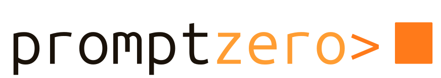

<!-- Translated copies: README.zh-CN.md, README.ja.md, README.de.md, README.fr.md, README.es.md, README.pt-BR.md. Update them in the same change. -->
<p align="center">
  <picture>
    <source media="(prefers-color-scheme: dark)" srcset=".github/assets/logo-dark.svg">
    
  </picture>
</p>

<p align="center"><a href="README.md">English</a>&emsp;<a href="README.zh-CN.md">简体中文</a>&emsp;<a href="README.ja.md">日本語</a>&emsp;<a href="README.de.md">Deutsch</a>&emsp;<a href="README.fr.md">Français</a>&emsp;<a href="README.es.md">Español</a>&emsp;<b>Português</b></p>

<h3 align="center">Fale com o seu Flipper Zero como se fala com uma pessoa — ele cria o payload, faz o deploy e o executa</h3>

<p align="center">Um operador em linguagem natural para o Flipper Zero e o ESP32 Marauder.<br>
Sub-GHz, NFC, RFID, IR, BadUSB e WiFi — conduzido pelo Claude, controlado por um motor de risco.</p>

<p align="center">
  <a href="https://github.com/xunholy/promptzero/releases/latest"></a>
  <a href="LICENSE"></a>
  <a href="https://github.com/xunholy/promptzero/actions/workflows/ci.yaml"></a>
  <a href="go.mod"></a>
  <a href="docs/reference/transports.md"></a>
  <a href="scripts/claude-usage.py"></a>
</p>

<p align="center">
  <a href="#início-rápido"><b>Início&nbsp;rápido</b></a>&emsp;
  <a href="#o-que-ele-faz"><b>O&nbsp;que&nbsp;ele&nbsp;faz</b></a>&emsp;
  <a href="#modos"><b>Modos</b></a>&emsp;
  <a href="#modelo-de-segurança"><b>Segurança</b></a>&emsp;
  <a href="docs/"><b>Docs</b></a>
</p>

> [!CAUTION]
> **Uso autorizado apenas.** O PromptZero gera e executa payloads de RF, NFC, RFID e HID — ilegais fora de contextos que você possui ou tem autorização por escrito para testar. Leia [`SECURITY.md`](SECURITY.md) para conhecer o modelo de segurança e o limite de ameaças. O projeto está em desenvolvimento ativo; APIs e ferramentas mudam entre versões menores.
>
> *Desenvolvido de ponta a ponta com o [Claude](https://claude.ai). Revise os payloads gerados antes do deploy.*

<p align="center">
  
</p>

Descreva o que você quer em uma frase. O PromptZero conversa com o seu Flipper Zero (e com uma devboard WiFi ESP32 Marauder opcional) por serial USB ou BLE, gera o payload, faz o deploy dele no cartão SD e o executa — com cada ação arriscada passando por um gate de consentimento e sendo registrada em um log de auditoria pelo caminho.

```
promptzero> make me a Starbucks WiFi captive portal
  Generated and deployed evil_portal to /ext/apps_data/evil_portal/index.html
  Evil portal started on Marauder devboard

promptzero> scan for nearby WiFi networks and deauth the strongest one
  Found 12 access points. Strongest: "NETGEAR-5G" (-31 dBm, channel 6)
  Selected AP 0. Deauth attack running...

promptzero> create a BadUSB payload that opens a reverse shell on Windows
  Generated and deployed badusb to /ext/badusb/generated_payload.txt
  Ready to execute - plug into target and run

promptzero> identify this device: /tmp/remote.jpg
  That's a Samsung BN59 series TV remote using the Samsung32 IR protocol.
  I can generate a complete remote file. Want me to create it?
```

## Início rápido

**Pré-requisitos** — um Flipper Zero com firmware modificado (Momentum / Unleashed / RogueMaster), uma chave de API da Anthropic e um cabo USB.

```bash
# 1. Install (Linux/macOS, amd64/arm64) — pinned to release artifacts (immutable per tag)
curl -fsSL https://github.com/xunholy/promptzero/releases/latest/download/install.sh | sh

# 2. Configure
export ANTHROPIC_API_KEY="sk-ant-..."

# 3. Run
promptzero
```

```
promptzero> what's connected?
  Flipper Zero — firmware 0.99.1, hardware v7.4
  Battery 84 % | SD card 4.1 GB free / 7.4 GB total
```

É todo o onboarding. A partir daqui, digite instruções em linguagem natural ou `/help` para ver os slash commands.

> [!TIP]
> **Postura defensiva (proteção com uma única flag):** adicione `--read-only` para recusar qualquer ferramenta que escreve, transmite ou executa. Leituras / varreduras / consultas puras ainda são despachadas; qualquer coisa de risco Médio ou acima é recusada no limite.
>
> ```bash
> promptzero --read-only          # blue-team / forensics / training
> ```

**Outros caminhos:** usuários de Windows baixam o `.zip` da [página de releases](https://github.com/xunholy/promptzero/releases). O WSL2 precisa de USB passthrough — veja [Transports → WSL2](docs/reference/transports.md#wsl2-usb-passthrough). Para BLE sem fio, arquivos de configuração, personas, variáveis de ambiente e autoatualização: [referência de configuração](docs/reference/configuration.md).

## O que ele faz

O PromptZero controla tudo por linguagem natural — um único agente, um registro de ferramentas ao vivo que cresce a cada release e um gate de risco diante de qualquer coisa que toca o mundo.

| Subsistema | Recursos |
|---|---|
| **Flipper Zero** | Sub-GHz TX/RX, IR TX/RX, detecção/emulação de NFC, leitura/escrita/emulação de RFID, iButton, GPIO, BadUSB, armazenamento, lançador de apps |
| **ESP32 Marauder** | varredura WiFi, deauth, beacon spam, probe flood, captura de PMKID, evil portal, BLE spam, varredura BT, detecção de skimmer, wardriving, spoofing de MAC |
| **Geração com IA** | HTML de evil portal, DuckyScript BadUSB, `.sub` Sub-GHz, `.ir` IR, `.nfc` NFC a partir de linguagem natural — além de construtores paramétricos para parâmetros tipados |
| **Inteligência** | Análise de imagem via Claude vision (caminho do arquivo → identificação do dispositivo + vetor de ataque), descoberta no cartão SD |
| **Auditoria** | Log de auditoria SQLite com tags de técnicas MITRE ATT&CK, exportação de sessão, estatísticas |

Execute `promptzero` e digite `/tools` para o registro ao vivo.

<details>
<summary><b>Nos bastidores — a camada do agente</b></summary>
<br>

O agente do PromptZero vem com prompt caching, roteamento de modelos por faixa de custo (recon no Haiku, exploração no Opus), quarentena de prompt injection, reflexion-on-error com `ToolError` estruturado, um oráculo `<device-state>` injetado a cada turno e spans GenAI do OpenTelemetry. O LLM é um componente, não uma biblioteca: trocas de modelo e de provedor são de primeira classe, e nenhum prompt é indispensável. Veja [`docs/`](docs/) para detalhes de arquitetura.

</details>

## Modos

### CLI — `promptzero`

O padrão. Um REPL interativo.

```
promptzero> scan the SD card and show me what signals I have saved
promptzero> transmit the garage door signal
promptzero> read the NFC tag on my desk
```

Slash commands (execute `/help` para a lista completa com descrições):

- **Conversa** — `/help`, `/reset`, `/quit`
- **Sessão** — `/sessions`, `/save <name>`, `/resume <id>`, `/forget <id>`
- **Informações** — `/status`, `/tools [query|page <n>]`, `/history [N]`, `/audit {stats|find|tail|top|session|query|export}`, `/stats [section]`, `/cost`, `/budget [set <USD>|off]`, `/debug`
- **Operador** — `/persona [name]`, `/mode [name]`, `/watch [pause|resume]`, `/webhooks [test <name>]`, `/validate <path>`, `/attack {set|clear} <techniques>`, `/campaign {validate|run} <file>`, `/rewind [snapshot]`, `/report [session] [json] [save]`, `/rules [list|pause|resume|test]`
- **Dispositivo** — `/reconnect`

Teclas durante um turno:

- **Ctrl+C** — cancela o turno atual por completo.
- **Ctrl+G** — aborta a ferramenta de streaming atual (p. ex. `subghz_receive`, `wifi_scan_ap`), mas deixa o agente continuar com o resultado parcial.
- **Ctrl+R** — busca reversa incremental no histórico.
- **Ctrl+L** — limpa a tela.

### Web UI — `promptzero --web`

Uma interface de navegador com tema escuro em `http://localhost:8080`: a superfície de chat, um viewport ao vivo do Flipper, um navegador de arquivos, o log de auditoria, um construtor de relatórios e — quando um Marauder está conectado — um painel de display TFT.

> [!IMPORTANT]
> **Autenticação.** Defina `web.token` na sua configuração ou `PROMPTZERO_WEB_TOKEN` no ambiente. O navegador captura `#token=…` do fragmento da URL no primeiro carregamento e o armazena em cache no `sessionStorage`. Token vazio + bind fora de loopback → o servidor imprime um aviso em vermelho. O PromptZero fala HTTP puro — termine o TLS em um proxy reverso (Caddy / Traefik / nginx) ou em um túnel Tailscale / Cloudflare.

**Hospede com Docker.** Imagens multi-arch (`distroless`, assinadas, com SBOM + proveniência) são publicadas em `ghcr.io/xunholy/promptzero` a cada release — veja [docs/deploy/docker.md](docs/deploy/docker.md).

**Sondas de saúde.** `GET /healthz` (liveness, `200 ok`) e `GET /readyz` (readiness, snapshot JSON dos subsistemas) não exigem autenticação para deploys headless / systemd / k8s; a conectividade do dispositivo é reportada, mas não condiciona a prontidão (um Flipper/Marauder pode se conectar após a inicialização).

### Voz — `promptzero --voice`

Push-to-talk no modo CLI. Pressione Enter sem texto para gravar (requer `sox`); o áudio é transcrito via OpenAI Whisper e depois processado como um comando normal.

```
Ubuntu/Debian:  apt install sox
macOS (brew):   brew install sox
Arch:           pacman -S sox
```

### MCP — `promptzero --mcp`

Roda como um servidor [Model Context Protocol](https://modelcontextprotocol.io/) sobre stdio. Adicione ao Claude Desktop / Claude Code:

```json
{
  "mcpServers": {
    "promptzero": {
      "command": "/path/to/promptzero",
      "args": ["--mcp"]
    }
  }
}
```

> [!IMPORTANT]
> **Gate de risco do MCP.** Ferramentas de risco Alto e Crítico são recusadas por padrão — defina `PROMPTZERO_MCP_ALLOW_HIGH=1` e / ou `PROMPTZERO_MCP_ALLOW_CRITICAL=1` para permiti-las. Todas as chamadas MCP (permitidas ou negadas) são registradas no log de auditoria. Veja [Modelo de segurança](#modelo-de-segurança) abaixo.

## Modelo de segurança

O PromptZero é um ferramental ofensivo de uso duplo. A história de segurança é a licença social de existência do projeto — cada spec carrega uma faixa de risco, e a faixa decide o que é despachado livremente e o que precisa ser confirmado.

 &nbsp;varreduras, leituras e consultas — despachadas livremente.<br>
 &nbsp;escritas de dados e emulação de sinal.<br>
 &nbsp;transmissão ativa de RF, escrita em tags e execução de scripts — **confirmação do operador obrigatória.**<br>
 &nbsp;ataques de força bruta e destrutivos — **confirmação do operador obrigatória.**

- **Gate de consentimento.** Ferramentas de risco Alto e Crítico exigem confirmação do operador. O CLI mostra uma prévia em caixa (frequência / modulação / hex) com um atraso de 2 segundos; o consentimento positivo (`y`, `all`, `confirm`) é rejeitado antes de o atraso se abrir. Decisões negativas (`n`, `r` para revisar, Esc) ignoram o atraso.
- **O MCP recusa por padrão.** Nenhum cliente MCP pode executar ferramentas Alto+ sem opt-in explícito por variável de ambiente (veja acima).
- **Log de auditoria à prova de falhas (fail-closed).** Se nenhum log de auditoria estiver inicializado, o agente recusa ações Alto+ em vez de executá-las silenciosamente.
- **Quarentena de prompt injection.** As saídas de ferramentas (SSIDs escaneados, pacotes capturados, conteúdo de imagem, nomes de arquivos do SD) são encapsuladas antes de serem realimentadas ao modelo, para que não possam sobrepor o system prompt.
- **Sem deploy automático de payloads gerados.** Scripts BadUSB são implantados sem execução por padrão.

Leia [`SECURITY.md`](SECURITY.md) para o modelo de ameaças completo, o escopo / fora de escopo e como reportar uma vulnerabilidade.

## Compatibilidade

<details open>
<summary><b>Suporte a firmware</b></summary>
<br>

| Firmware | Status |
|---|---|
| **Momentum** (antigo Xtreme) | Alvo principal |
| **Unleashed** | Suportado |
| **RogueMaster** | Suportado |
| **Oficial (OFW) 1.x** | Suportado com um conjunto reduzido de recursos — Sub-GHz bloqueado por região, sem rolling code |

</details>

> [!NOTE]
> O firmware oficial restringe a transmissão Sub-GHz às bandas ISM específicas de cada região e bloqueia protocolos de rolling code. O firmware modificado libera toda a faixa do CC1101 (300–348 / 387–464 / 779–928 MHz) e habilita TX para todos os 52 protocolos suportados.

A devboard ESP32 Marauder requer firmware **v1.11.1+** sobre USB CDC ACM (`/dev/ttyACM1` para a devboard WiFi oficial do Flipper, baud 115200). Para BLE sem fio (sem cabo, todas as ferramentas funcionam, ~10× mais lento que USB) e pareamento por plataforma, veja a [referência de Transports](docs/reference/transports.md).

## Documentação

- [`docs/`](docs/) — manual com cenários orientados a tarefas, padrões de prompt e transcrições reproduzíveis.
- [`docs/reference/tools.md`](docs/reference/tools.md) — uma referência curada dos schemas das ferramentas **essenciais**, dos níveis de risco e dos prompts que as acionam de forma confiável. Execute `/tools` (ou `tool_search`) para o registro ao vivo completo.
- [`docs/reference/transports.md`](docs/reference/transports.md) — configuração de serial, BLE e WSL2.
- [`docs/reference/configuration.md`](docs/reference/configuration.md) — arquivo de configuração, variáveis de ambiente, personas, regras, autoatualização.
- [`SECURITY.md`](SECURITY.md) — modelo de ameaças e política de divulgação.
- [`examples/`](examples/) — modelos para copiar e colar: configuração, regras, quatro personas de operador (red team / blue team / CTF / laboratório de hardware).
- [`CHANGELOG.md`](CHANGELOG.md) — o que há em cada release.

## Compilação e contribuição

Veja [`CONTRIBUTING.md`](CONTRIBUTING.md). Versão resumida:

```bash
git clone https://github.com/xunholy/promptzero.git
cd promptzero
task dev:setup
task build
task test
```

## Licença

[AGPL-3.0-or-later](LICENSE). Hospedar um PromptZero modificado como serviço de rede exige publicar as alterações do código-fonte sob a mesma licença.

<br>

<sub align="center">O badge de uso/custo do Claude é uma estimativa agregada a partir das transcrições locais do Claude Code do mantenedor (`task claude-usage`); ele reflete apenas as sessões daquela máquina.</sub>

<p align="center"><sub>Desenvolvido com <a href="https://claude.ai">Claude</a> por <a href="https://github.com/xunholy">xunholy</a>.</sub></p>
